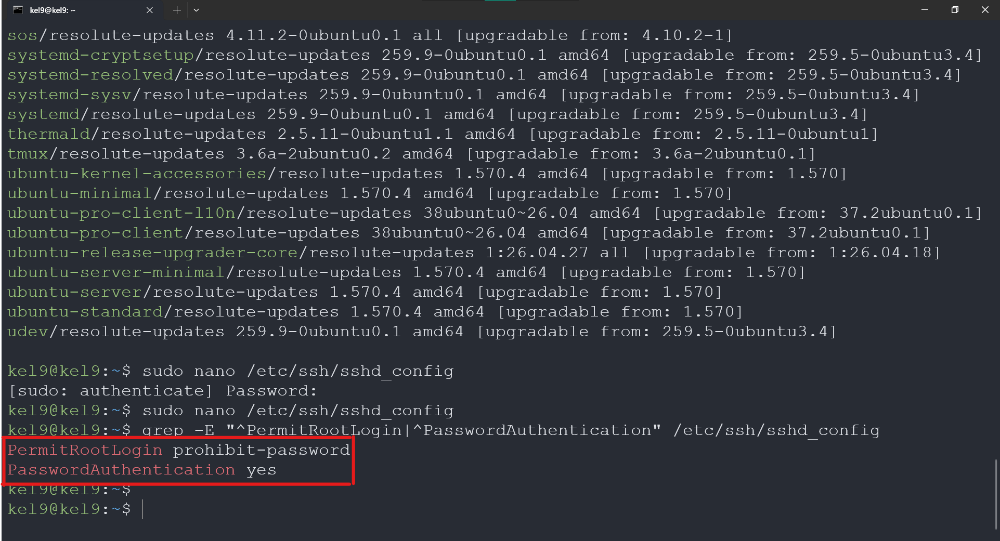
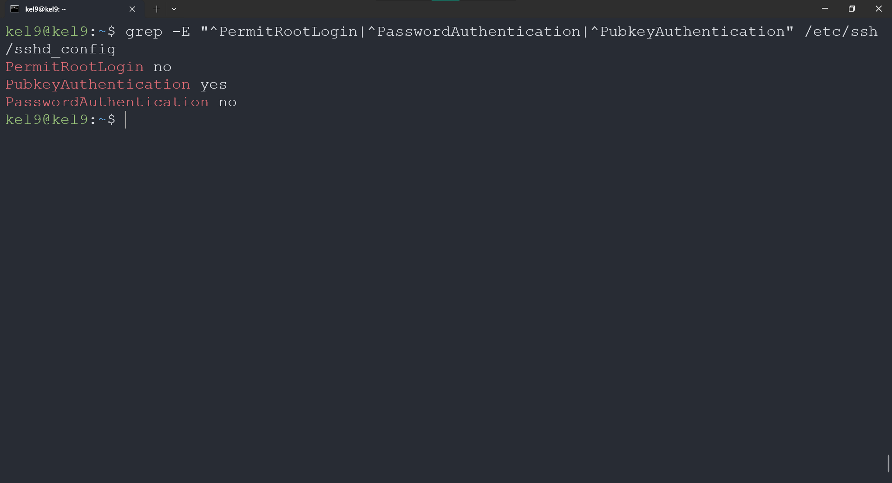
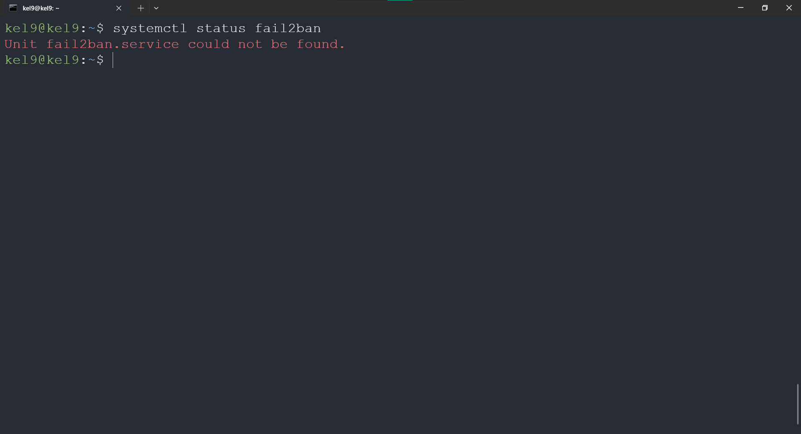
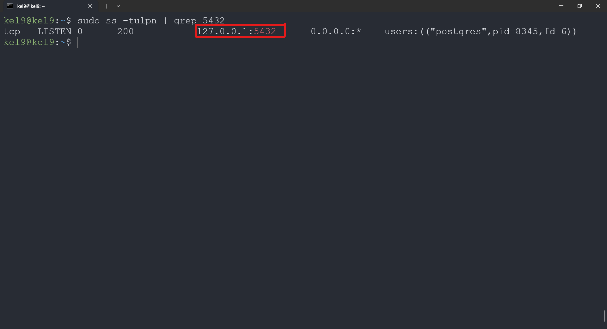
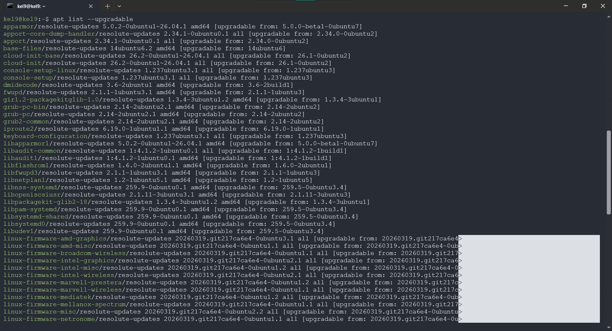
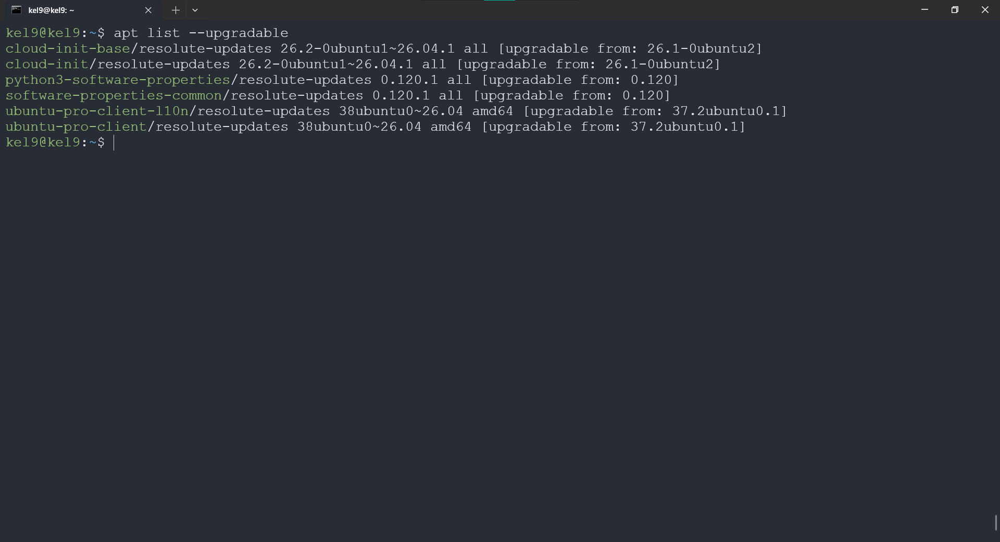
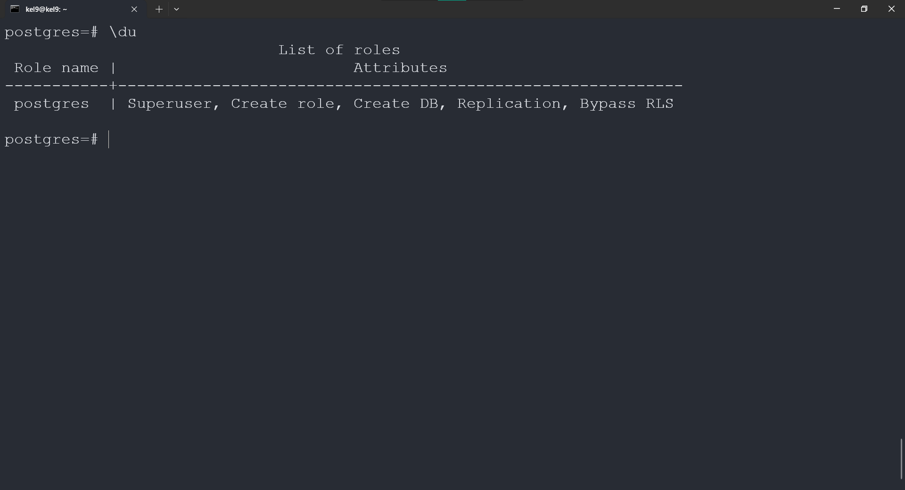
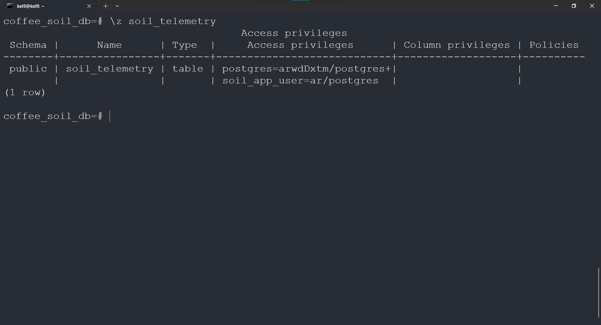
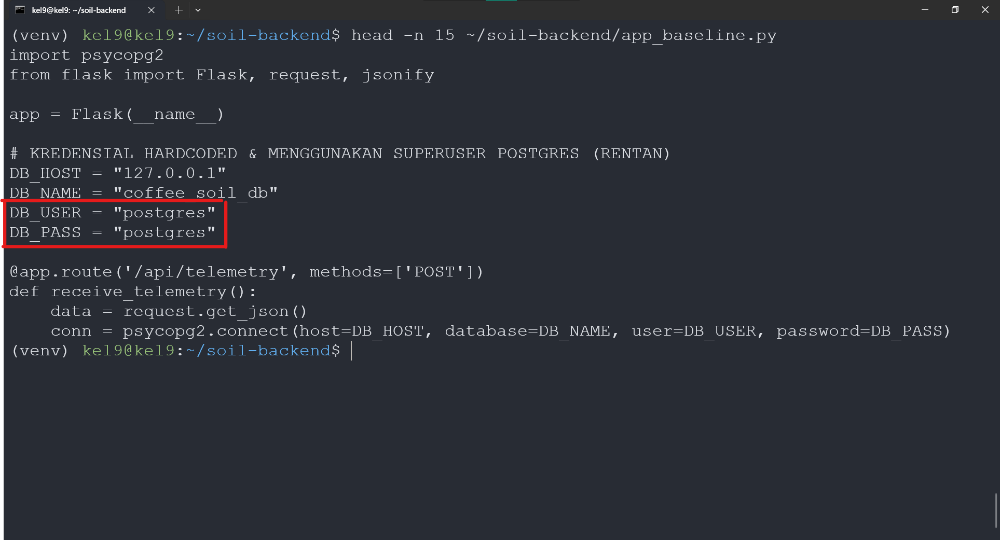
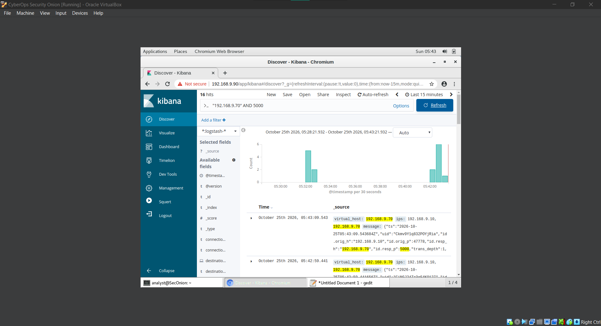

# Checklist Hardening Target Node Replika (Blue Team)

**Kelompok:** Kelompok 9 - Kelas B
**Target Node:** Ubuntu Server - Replika Backend Smart Soil Monitoring Kopi (`192.168.9.70`)

Dokumen ini memuat implementasi **9 kontrol hardening** yang tersebar pada 3 kategori (Access & Authentication, Service & Attack Surface, serta Data & Application) beserta bukti _Before vs After_.

---

## Ringkasan Status Hardening

|  Kode  | Kategori          | Kontrol Hardening yang Diterapkan                                                         | Status  | Lokasi Bukti                           |
| :----: | :---------------- | :---------------------------------------------------------------------------------------- | :-----: | :------------------------------------- |
| **A1** | Access & Auth     | Nonaktifkan login `root` langsung pada SSH (`PermitRootLogin no`)                         | Selesai | `evidence/a1_a2_ssh_after.png`         |
| **A2** | Access & Auth     | Penerapan _SSH Key-Based Authentication_ & penonaktifan login password                    | Selesai | `evidence/a1_a2_ssh_denied.png`        |
| **A3** | Access & Auth     | Pembatasan percobaan login (_rate-limiting_) SSH menggunakan `fail2ban`                   | Selesai | `evidence/a3_fail2ban_after.png`       |
| **B1** | Service & Surface | Penonaktifan service tidak terpakai & pengikatan PostgreSQL (`5432`) hanya ke `localhost` | Selesai | `evidence/b1_postgres_local_after.png` |
| **B2** | Service & Surface | Konfigurasi _Host Firewall_ (`ufw`) dengan metode _whitelist_ (hanya Port `22` & `5000`)  | Selesai | `evidence/b2_ufw_after.png`            |
| **B3** | Service & Surface | Pembaruan & _patching_ paket Sistem Operasi Ubuntu Server ke versi aman                   | Selesai | `evidence/b3_patch_after.png`          |
| **C1** | Data & App        | Penerapan _Least-Privilege_ pada user Database PostgreSQL (`soil_app_user`)               | Selesai | `evidence/c1_db_role_after.png`        |
| **C2** | Data & App        | Pemindahan kredensial DB & token API dari _hardcoded_ ke `.env` (`chmod 600`)             | Selesai | `evidence/c2_env_after.png`            |
| **C3** | Data & App        | Validasi rentang input telemetri tanah, otorisasi `X-API-Key`, & _security logging_       | Selesai | `evidence/c3_api_log_after.png`        |

---

## Detail Bukti Before vs After per Kategori

### Kategori A: Access & Authentication

#### 1. Kontrol A1 & A2: Penonaktifan Root Login & Implementasi SSH Key-Based Auth

- **Kondisi Sebelum (Before):** Konfigurasi `/etc/ssh/sshd_config` masih mengizinkan autentikasi password dan login langsung ke akun `root`.
  
- **Kondisi Sesudah (After):** Parameter diubah menjadi `PermitRootLogin no` dan `PasswordAuthentication no`.
  
- **Bukti Percobaan Login Gagal:** Percobaan login tanpa _private key_ yang sah dari `192.168.9.10` langsung ditolak oleh server (`Permission denied (publickey)`).
  

#### 2. Kontrol A3: Rate-Limit Percobaan Login dengan `fail2ban`

- **Kondisi Sebelum (Before):** Layanan `fail2ban` belum aktif sehingga percobaan _brute-force_ tidak diblokir otomatis.
  
- **Kondisi Sesudah (After):** Jail `[sshd]` diaktifkan dengan batas `maxretry = 3` dan `bantime = 600`.
  

---

### Kategori B: Service & Attack Surface

#### 3. Kontrol B1 & B2: Isolasi Port Layanan & Whitelist Firewall (`ufw`)

- **Kondisi Sebelum (Before):** Hasil pemindaian `nmap` dari Attacker Node (`192.168.9.10`) menunjukkan port database PostgreSQL (`5432`) terbuka ke jaringan eksternal dan firewall belum aktif.
  
- **Kondisi Sesudah - Isolasi PostgreSQL (After B1):** Database diatur hanya mendengarkan pada `127.0.0.1` (`localhost`) karena hanya diakses oleh service Flask lokal.
  
- **Kondisi Sesudah - Aturan Firewall (After B2):** `ufw` diaktifkan dengan kebijakan _default deny incoming_ dan hanya membuka port `22/tcp` serta `5000/tcp`.
  
- **Bukti Nmap Scan After:** Port `5432` tidak lagi terekspos ke jaringan luar (_filtered_).
  

#### 4. Kontrol B3: Update & Patch Sistem Operasi

- **Kondisi Sebelum (Before):** Terdapat paket sistem pada Ubuntu Server yang membutuhkan pembaruan keamanan.
  
- **Kondisi Sesudah (After):** Seluruh paket telah diperbarui ke versi aman melalui `apt upgrade`.
  

---

### Kategori C: Data & Application

#### 5. Kontrol C1: Least-Privilege pada User Database PostgreSQL

- **Kondisi Sebelum (Before):** Aplikasi backend menggunakan akun superuser `postgres` yang memiliki hak penuh untuk menghapus tabel maupun database.
  
- **Kondisi Sesudah (After):** Dibuat akun khusus `soil_app_user` yang hanya diberi hak `SELECT` dan `INSERT` (`ar`) pada tabel `soil_telemetry`.
  

#### 6. Kontrol C2: Penyimpanan Kredensial pada Environment Variable (`.env`)

- **Kondisi Sebelum (Before):** Kredensial koneksi database tertulis langsung (_hardcoded_) di dalam kode sumber aplikasi.
  
- **Kondisi Sesudah (After):** Kredensial dan token API dipindahkan ke file `.env` dengan hak akses ketat `-rw-------` (`chmod 600`).
  

#### 7. Kontrol C3: Validasi Input Endpoint HTTP API & Pencatatan Log Mencurigakan

- **Kondisi Sebelum (Before):** Endpoint `/api/telemetry` menerima kiriman data dari siapa saja tanpa pengecekan token ESP32 dan tanpa memvalidasi batas wajar nilai pH/kelembaban tanah.
  
- **Kondisi Sesudah (After):** Endpoint memeriksa header `X-API-Key`, menolak nilai sensor di luar batas wajar (`422 Unprocessable Entity`), menggunakan _parameterized query_, dan mencatat setiap anomali ke `soil_security.log`.
  

---

## Ringkasan Baseline Traffic Normal (Security Onion - `192.168.9.90`)

Pemantauan trafik normal pada jaringan internal `siber` melalui **Kibana (Zeek Logs)** saat simulator sensor (`192.168.9.10`) mengirimkan data telemetri tanah secara berkala ke endpoint HTTP API Target Node (`192.168.9.70:5000`):

- **Filter Observasi Kibana:** Query `"192.168.9.70" AND 5000` digunakan untuk mengisolasi trafik layanan aplikasi IoT dari trafik manajemen lainnya (seperti SSH port `22`).
- **Identitas Koneksi pada Log Zeek:** Tercatat komunikasi TCP/HTTP normal dari `id.orig_h: "192.168.9.10"` (ephemeral port) menuju `id.resp_h: "192.168.9.70"` pada `id.resp_p: 5000` (`virtual_host: 192.168.9.70`).
- **Pola & Interval Pengiriman Normal:** Simulator mengirimkan 1 request `HTTP POST /api/telemetry` setiap **10 detik** secara konsisten—terverifikasi langsung pada selisih _timestamp_ log berurutan di Kibana (`05:42:59.441` ke `05:43:09.543`). Pada grafik histogram (`@timestamp per 30 seconds`), 3 kali pengiriman dalam jendela 30 detik menghasilkan sekitar 6 _events_ (gabungan pencatatan `http.log` dan `conn.log` oleh sensor Zeek).

