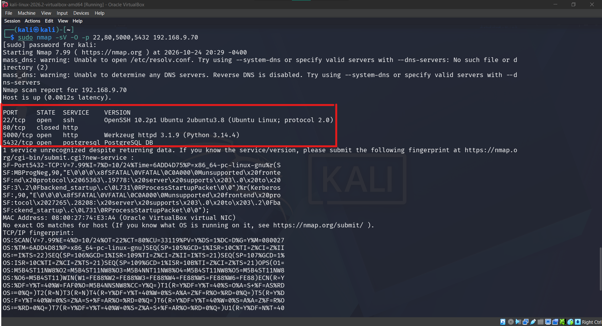
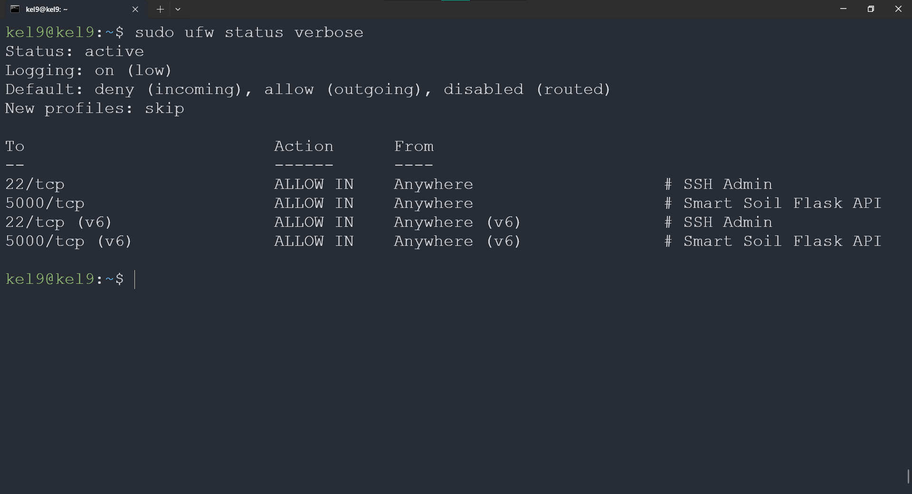
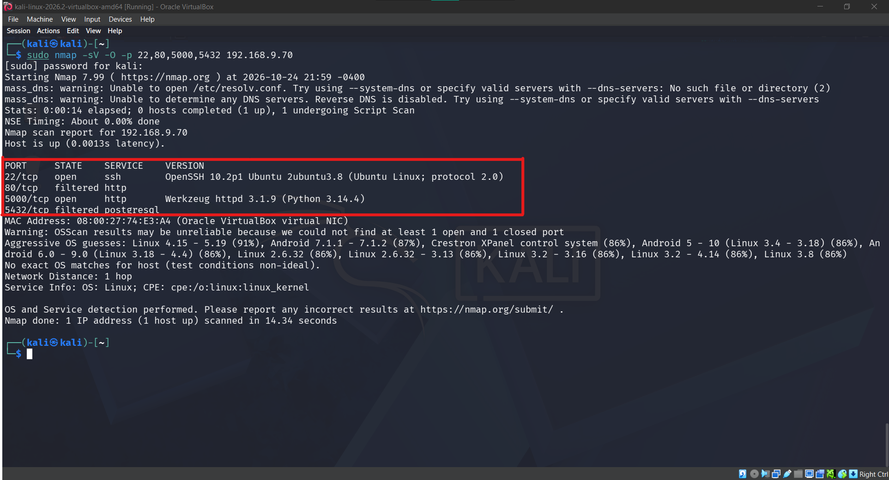
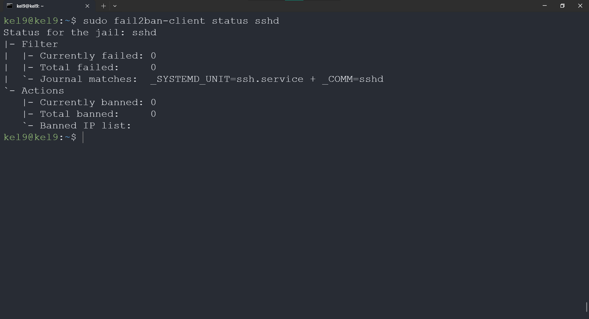
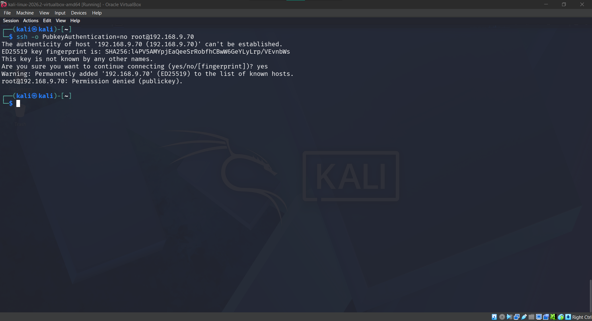
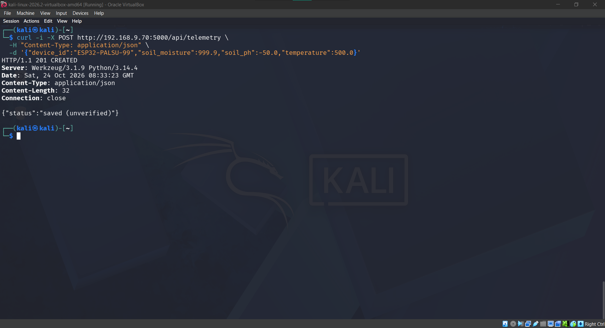
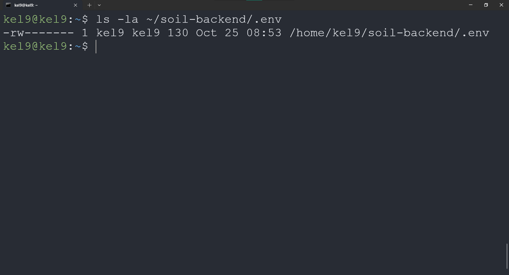
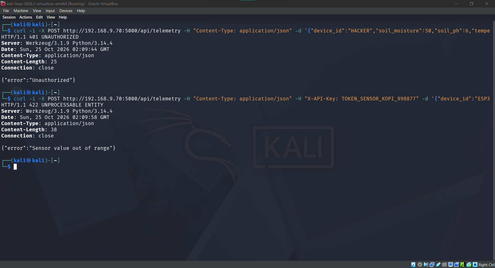

# Log Purple Team Loop (Fase 2 - Minggu 9 s.d. 11)

**Kelompok:** Kelompok 9 - Kelas B
**Proyek IoT:** Smart Soil Monitoring System untuk Tanaman Kopi
**Topologi Lab:** Attacker Kali (`192.168.9.10`) $\rightarrow$ Target Ubuntu (`192.168.9.70`) | Monitoring Security Onion (`192.168.9.90`)

Dokumen ini mencatat siklus tertutup 5 tahap (_Serang $\rightarrow$ Deteksi $\rightarrow$ Analisis $\rightarrow$ Respons/Mitigasi $\rightarrow$ Verifikasi_) antara Red Team dan Blue Team untuk setiap skenario pengujian Fase 2.

> **Keterangan Progres Minggu ke-9:** Kerangka skenario, analisis _root cause_, pengujian baseline awal, dan implementasi kontrol mitigasi Blue Team telah disiapkan pada Minggu ke-9. Eksekusi pengujian penuh Red Team dan verifikasi alert SIEM dijadwalkan berlangsung pada Minggu ke-10 s.d. Minggu ke-11.

---

## Skenario 1: Pemetaan Port & Layanan Database Backend (Reconnaissance)

| Tahap                     | Aktivitas Red Team (`192.168.9.10`)                                                                                               | Aktivitas Blue Team (`192.168.9.70` & `192.168.9.90`)                                                                                           |       Status        | Bukti Dokumentasi                                                           |
| :------------------------ | :-------------------------------------------------------------------------------------------------------------------------------- | :---------------------------------------------------------------------------------------------------------------------------------------------- | :-----------------: | :-------------------------------------------------------------------------- |
| **1. Serang (Baseline)**  | Menjalankan `nmap -sV -O` ke `192.168.9.70` saat firewall belum membatasi port database.                                          | Mengamati keterbukaan port layanan sebelum _host firewall_ diaktifkan.                                                                          | Selesai (Uji Awal)  |                    |
| **2. Deteksi**            | -                                                                                                                                 | Mengidentifikasi alert pemindaian port (`ET SCAN`) pada dashboard Security Onion dan memeriksa koneksi aktif.                                   | Terjadwal Minggu 10 | Target file: `redteam/evidence/s1_t2_so_alert.png` _(Dieksekusi Minggu 10)_ |
| **3. Analisis**           | Menjelaskan bahwa terbukanya port `5432` memungkinkan penyerang menyerang database PostgreSQL secara langsung tanpa melewati API. | Menganalisis _root cause_: PostgreSQL mendengarkan pada seluruh interface (`*`) dan `ufw` belum menerapkan kebijakan _whitelist_.               |       Selesai       | _Lihat catatan analisis di bawah tabel_                                     |
| **4. Respons (Mitigasi)** | -                                                                                                                                 | Mengubah `listen_addresses = 'localhost'` di `postgresql.conf` (Kontrol B1) dan mengaktifkan `ufw` hanya untuk port `22` & `5000` (Kontrol B2). |       Selesai       |                          |
| **5. Verifikasi**         | Mengulangi scan `nmap` yang sama ke `192.168.9.70` setelah mitigasi diterapkan.                                                   | Mengonfirmasi port `5432` kini berstatus _filtered/closed_ dari jaringan luar.                                                                  | Selesai (Uji Awal)  |                       |

**Catatan Analisis Root Cause (Skenario 1):**
Pada kondisi baseline, port `5432` terbuka ke jaringan eksternal karena parameter `listen_addresses` mengizinkan seluruh interface dan _host-based firewall_ (`ufw`) belum diaktifkan. Padahal dalam alur sistem Smart Soil Monitoring, komunikasi eksternal dari ESP32 hanya membutuhkan endpoint HTTP REST API (`Port 5000`), sementara komunikasi ke database PostgreSQL berlangsung secara internal di dalam server. Pengikatan layanan database ke `127.0.0.1` dikombinasikan dengan aturan _default deny incoming_ pada `ufw` menutup eksposur database dari jaringan luar.

---

## Skenario 2: Brute-Force Kredensial Administrasi SSH (Exploitation / Akses)

| Tahap                     | Aktivitas Red Team (`192.168.9.10`)                                                                                                      | Aktivitas Blue Team (`192.168.9.70` & `192.168.9.90`)                                                                                 |           Status            | Bukti Dokumentasi                                                               |
| :------------------------ | :--------------------------------------------------------------------------------------------------------------------------------------- | :------------------------------------------------------------------------------------------------------------------------------------ | :-------------------------: | :------------------------------------------------------------------------------ |
| **1. Serang (Baseline)**  | Menjalankan `Hydra` terhadap layanan SSH (`192.168.9.70:22`) menggunakan daftar password umum pada kondisi `PasswordAuthentication yes`. | Memantau log autentikasi dan dashboard Security Onion saat serangan berlangsung.                                                      |     Terjadwal Minggu 10     | Target file: `redteam/evidence/s2_t1_hydra_attack.png` _(Dieksekusi Minggu 10)_ |
| **2. Deteksi**            | -                                                                                                                                        | Mengidentifikasi rentetan pesan `Failed password` pada `/var/log/auth.log` dan alert SSH brute-force di Security Onion.               |     Terjadwal Minggu 10     | Target file: `redteam/evidence/s2_t2_auth_log.png` _(Dieksekusi Minggu 10)_     |
| **3. Analisis**           | Menjelaskan teknik _dictionary attack_ untuk menebak kredensial akun server cloud.                                                       | Menganalisis _root cause_: autentikasi berbasis password masih diizinkan dan belum ada pembatasan _rate-limit_ percobaan login.       |           Selesai           | _Lihat catatan analisis di bawah tabel_                                         |
| **4. Respons (Mitigasi)** | -                                                                                                                                        | Menonaktifkan login root & password di `sshd_config` (Kontrol A1 & A2) serta mengaktifkan jail `[sshd]` pada `fail2ban` (Kontrol A3). |           Selesai           |                      |
| **5. Verifikasi**         | Menguji percobaan akses SSH tanpa kunci privat serta mengulangi pengujian `Hydra` pada Minggu 10.                                        | Mengonfirmasi akses tanpa SSH Key langsung ditolak (`Permission denied (publickey)`) dan `fail2ban` siap memblokir IP penyerang.      | Sebagian (Lanjut Minggu 10) |                            |

**Catatan Analisis Root Cause (Skenario 2):**
Konfigurasi awal OpenSSH yang mengizinkan `PasswordAuthentication yes` dan `PermitRootLogin yes` tanpa mekanisme _rate-limiting_ memungkinkan penyerang melakukan percobaan autentikasi masif secara otomatis. Dengan menonaktifkan autentikasi berbasis password, beralih sepenuhnya ke _SSH Key-Based Authentication_, serta menerapkan `fail2ban` (`maxretry = 3`), percobaan _brute-force_ ditolak pada lapisan protokol sekaligus memblokir IP sumber serangan secara otomatis.

---

## Skenario 3: Spoofing Data Telemetri Kopi & Injeksi Input API (Web / API / Protokol IoT)

| Tahap                     | Aktivitas Red Team (`192.168.9.10`)                                                                                                                          | Aktivitas Blue Team (`192.168.9.70` & `192.168.9.90`)                                                                                                                                                                           |       Status        | Bukti Dokumentasi                                                           |
| :------------------------ | :----------------------------------------------------------------------------------------------------------------------------------------------------------- | :------------------------------------------------------------------------------------------------------------------------------------------------------------------------------------------------------------------------------ | :-----------------: | :-------------------------------------------------------------------------- |
| **1. Serang (Baseline)**  | Mengirimkan payload JSON palsu (tanpa token ESP32 & nilai pH `-50`) menggunakan `curl` ke `POST http://192.168.9.70:5000/api/telemetry` (`app_baseline.py`). | Mengamati masuknya data anomali ke tabel database tanpa penolakan pada kondisi awal.                                                                                                                                            | Selesai (Uji Awal)  |                   |
| **2. Deteksi**            | -                                                                                                                                                            | Mengidentifikasi trafik HTTP POST anomali di Kibana Security Onion dan mengevaluasi ketiadaan log keamanan pada aplikasi baseline.                                                                                              | Terjadwal Minggu 10 | Target file: `redteam/evidence/s3_t2_http_log.png` _(Dieksekusi Minggu 10)_ |
| **3. Analisis**           | Menjelaskan bagaimana penyerang dapat merusak akurasi pemantauan tanah kopi (_data poisoning_) jika endpoint API terbuka tanpa autentikasi.                  | Menganalisis _root cause_: ketiadaan verifikasi header `X-API-Key`, ketiadaan validasi batas nilai sensor, dan belum aktifnya _application logging_.                                                                            |       Selesai       | _Lihat catatan analisis di bawah tabel_                                     |
| **4. Respons (Mitigasi)** | -                                                                                                                                                            | Mengaktifkan `app.py` yang memverifikasi `X-API-Key` dari `.env` (Kontrol C2), memvalidasi rentang kelembaban/pH/suhu, menggunakan user DB terbatas (Kontrol C1), dan mencatat pelanggaran ke `soil_security.log` (Kontrol C3). |       Selesai       |                      |
| **5. Verifikasi**         | Mengirimkan ulang payload spoofing tanpa token dan nilai sensor ekstrem ke endpoint `POST /api/telemetry`.                                                   | Mengonfirmasi request ditolak dengan status `401 Unauthorized` / `422 Unprocessable Entity` dan tercatat lengkap di `soil_security.log`.                                                                                        | Selesai (Uji Awal)  |             |

**Catatan Analisis Root Cause (Skenario 3):**
Endpoint HTTP API pada versi awal mempercayai seluruh input dari klien tanpa memverifikasi identitas pengirim (perangkat ESP32) maupun kewajaran nilai fisis sensor tanah. Hal ini membuka celah _telemetry spoofing_ yang merusak integritas data agronomi kopi di database. Implementasi verifikasi token melalui header `X-API-Key` yang disimpan di `.env`, pembatasan rentang nilai (`moisture` 0–100%, `pH` 0–14, `temperature` -10 s.d. 60°C), penggunaan akun database _least-privilege_ (`soil_app_user`), serta pencatatan ke `soil_security.log` memastikan integritas data terlindungi dan insiden dapat diaudit.
